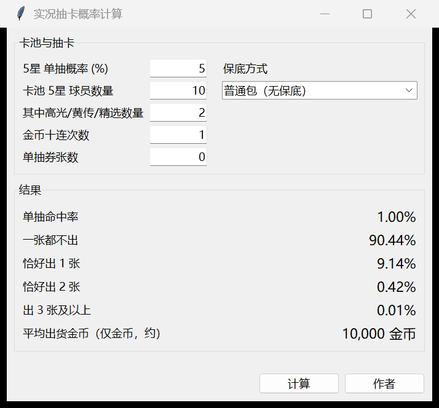
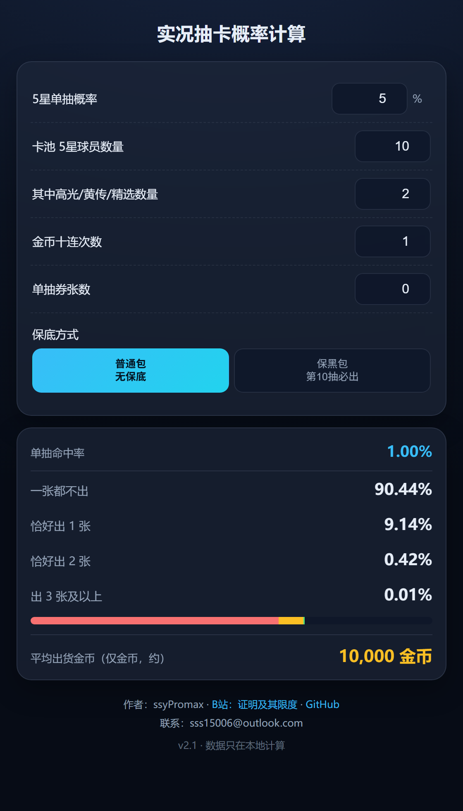

# 实况抽卡概率计算

一个给 eFootball / 实况足球玩家用的抽卡概率计算器：填上卡池参数和你的抽卡计划，算出**「一张都不出」的概率**和**平均要花多少金币**。

支持 Windows 桌面版、Android 手机版、纯网页版，计算逻辑三端一致（已用同一组数据交叉验证）。

[](https://github.com/ssyPromax/eFootball-Calc-Promax/releases/latest)
[](https://www.python.org/)
[](LICENSE)

## 下载

到 [Releases](https://github.com/ssyPromax/eFootball-Calc-Promax/releases/latest) 下载：

| 平台 | 文件 | 说明 |
|---|---|---|
| Windows | `实况抽卡概率计算.exe` | 单文件免安装。首次运行可能被 SmartScreen 拦截，见下方 FAQ |
| Windows | `实况抽卡概率计算-win64.zip` | 解压后双击 `启动.bat`，**不会弹 SmartScreen**，推荐给不熟悉提示的用户 |
| Android | `实况抽卡概率计算.apk` | Android 5.0+，安装时需允许「未知来源应用」 |
| 源码 | `实况抽卡概率计算Promax.py` | 需要 Python 3.9+ |

## 截图

| Windows / 桌面 | Android / 手机 |
|---|---|
|  |  |

## 功能

- **两种卡池规则**：普通包（无保底）、保黑包（第 10 抽必出 5 星）
- **金币十连 + 单抽券混合计算**
- **完整出货分布**：一张都不出 / 恰好 1 张 / 恰好 2 张 / 3 张及以上
- **平均出货金币**：按 100 金币一抽折算（十连 1000）
- **输入校验**：填错会提示，不会崩溃或输出负数概率
- **纯本地计算**：不联网、不上传数据、不申请任何权限

## 使用方法

### Windows

**方式一（推荐）**：下载 `实况抽卡概率计算-win64.zip`，解压后双击 `启动.bat`。

**方式二**：下载 `实况抽卡概率计算.exe`，双击运行。若出现蓝色「Windows 已保护你的电脑」窗口：

1. 点左下角「更多信息」；
2. 点「仍要运行」。

这是 Windows 对未签名程序的常规提醒，本程序不联网、不写注册表。

### Android

1. 下载 `实况抽卡概率计算.apk`；
2. 在手机上点击安装，若提示风险，选择「仍要安装」（这是自签名 APK，正常现象）；
3. 打开即可使用，无需联网。

### 纯网页

直接用浏览器打开 `web/index.html` 即可（手机、电脑都能用），也可以自己部署到任意静态托管。

### 源码运行

```bash
python 实况抽卡概率计算Promax.py
```

## 输入说明

| 输入 | 含义 | 例子 |
|---|---|---|
| 5星单抽概率 | 游戏里公示的单抽出 5 星概率 | `5` 表示 5% |
| 卡池 5星球员数量 | 这个卡池里一共有多少张 5 星 | `10` |
| 其中高光/黄传/精选数量 | 你想要的卡有几张 | `2` |
| 金币十连次数 | 准备抽几次十连（每次 10 抽、1000 金币） | `3` |
| 单抽券张数 | 除了金币，还准备用几张单抽券 | `5` |
| 保底方式 | 普通包 / 保黑包 | — |

## 计算模型

记号：

- $a_0$：单抽出 5 星的概率（0~1）
- $a$：卡池 5 星总数；$b$：其中目标卡数量
- $e = a_0 \cdot \dfrac{b}{a}$：**单抽命中目标**的概率
- $q = \dfrac{b}{a}$：一张 5 星恰好是目标的概率
- $c$：十连次数；$d$：单抽券张数

### 普通包（无保底）

每次抽卡独立，总抽数 $n = 10c + d$：

$$X \sim \mathrm{Binomial}(n, e), \qquad P(\text{不出}) = (1-e)^{n}$$

### 保黑包（第 10 抽必出 5 星）

每次十连 = 9 次普通抽 + 1 次必出 5 星：

$$X \sim \mathrm{Binomial}(9c, e) + \mathrm{Binomial}(c, q) + \mathrm{Binomial}(d, e)$$

### 平均出货金币

只统计金币抽（单抽券不折算），一抽按 100 金币：

- 普通包：$\dfrac{100}{e}$
- 保黑包：$\dfrac{1000}{9e+q}$

## 两种卡池规则怎么选

| 规则 | 适用情况 |
|---|---|
| 普通包（无保底） | 卡池说明里没有「必出」字样 |
| 保黑包（第 10 抽必出 5 星） | 十连固定保底一张 5 星 |

## 常见问题

**Q：Windows 提示「已保护你的电脑」/「不运行」，或者报 Could not create temporary directory!？**
A：exe 没有购买代码签名证书，SmartScreen 会拦未知发布者。点「更多信息」→「仍要运行」即可；或者直接下载 `实况抽卡概率计算-win64.zip`，解压后双击 `启动.bat`（这种方式不会弹提示）。

**Q：安卓提示「应用未安装 / 有风险」？**
A：APK 使用自签名证书，属于正常现象。在设置里允许该来源安装即可。

**Q：为什么算出来和游戏里感觉不一样？**
A：本工具假设**每次抽卡相互独立（有放回）**，并且单抽券与金币抽同概率。如果卡池是「箱子」（抽到即移出、不会重复），实际概率会随剩余数量变化，本工具不适用。

**Q：平均出货金币是什么？**
A：期望值，不是保底上限。保底上限取决于卡池总人数和保底规则。

## 已知限制

- 假设抽卡相互独立（有放回）；箱子型卡池不适用。
- 单抽券按与金币抽相同的概率计算。
- 只按 100 金币/抽折算。
- 保黑包按「每十连第 10 抽必出 5 星」计算。

## 开发与测试

```bash
# 计算层是纯函数，可以脱离界面单独测试（16 个用例，含 12 万次蒙特卡洛对拍）
python -m unittest -v test_calc.py

# 前端数学实现与 Python 版交叉验证（需要 Node.js）
node web/test_web.js
```

### 目录结构

```
实况抽卡概率计算Promax.py   Windows 桌面版（tkinter，单文件）
test_calc.py                单元测试
web/                        纯网页版（HTML + JS，APK 复用同一套资源）
```

### 重新打包

```bash
# Windows exe
pip install pyinstaller
pyinstaller --noconfirm --onefile --windowed --icon assets/app.ico --name 实况抽卡概率计算 实况抽卡概率计算Promax.py
```

Android APK 使用 `aapt2 + javac + d8 + apksigner` 手工流水线构建（无需 Gradle），WebView 加载 `web/` 下的离线页面。

## 更新日志

### v2.1（2026-10）

- 界面与安装包名称去掉「Promax」，统一为「实况抽卡概率计算」
- 保黑包只保留「第 10 抽必出 5 星」一种规则，移除第二种保底语义
- 5星概率默认值改为 5%
- 新增 Android APK（WebView 离线版）与 Windows 免安装 exe
- 新增 `启动.bat` 绿色包，绕开 SmartScreen 提示
- 修正保黑包「恰好出 1 张」概率的指数错误（原版高估约 8.6 个百分点）
- 单抽券改为与金币抽同概率（原版把券写死成 10%）
- 输入校验、高 DPI 适配、布局重做、结果统一为「0 / 1 / 2 / 3+ 张」
- 新增纯网页版，与 Python 版交叉验证

## 作者

- 邮箱：sss15006@outlook.com
- QQ：3192491461
- 大众评球：mc方
- B 站：[证明及其限度](https://space.bilibili.com/677960956)
- GitHub：[@ssyPromax](https://github.com/ssyPromax)

## License

[MIT](LICENSE)

